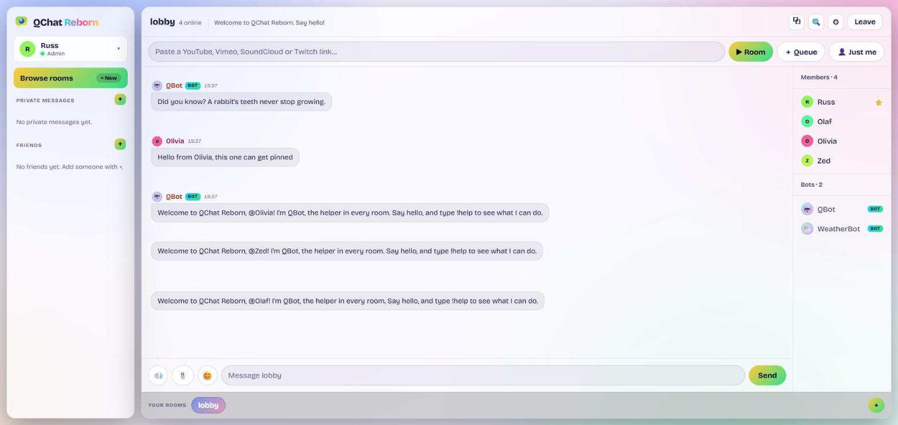
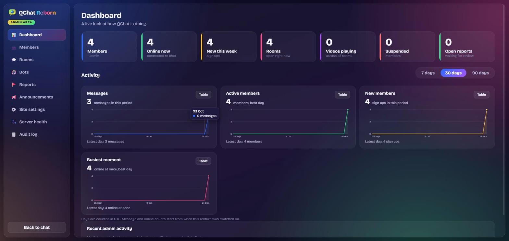

<div align="center">


# QChat Reborn

**Media Webchat, Reborn.**
A free, real-time chat community with rooms, friends, watch-together video and music, a word game,
helpful bots and live video, all in one small Node.js app.

[](https://qchat.co.uk)
[](https://nodejs.org)
[](https://www.typescriptlang.org)
[](https://react.dev)

[](#how-it-works)
[](#how-it-works)
[](#tests)
[](#accessible-by-design)
[](#privacy-and-safety)
[](LICENSE)
[](https://qchat.co.uk)

[**Visit qchat.co.uk**](https://qchat.co.uk) &nbsp;|&nbsp; [Terms](https://qchat.co.uk/terms) &nbsp;|&nbsp; [Privacy](https://qchat.co.uk/privacy) &nbsp;|&nbsp; [Run your own](#run-it-on-your-own-computer) &nbsp;|&nbsp; [Deploy](DEPLOYMENT.md)

</div>

<br />

<p align="center">
  
</p>

## What is QChat?

QChat started life in the early 2000s as a place to chat, share music and videos and make friends. **QChat Reborn** is the
same idea rebuilt from scratch for today: fast, colourful, friendly, and looked after by people rather than
algorithms. There is no advertising, no tracking and no cookies. You make a username, pick a room and talk.

Everything runs as **one small program with a built-in database**. There is nothing else to install, so anyone
can run their own copy.

## Highlights

<table>
<tr>
<td width="50%" valign="top">

### 💬 Chat that feels good
* Rooms anyone can create, with topics, rules and pinned messages
* Replies, reactions, pictures, mentions and `:emoji:` shortcodes
* Private messages and a friends list
* Saved history, search, edit and delete
* A pop-out window so chat stays in view while you browse

</td>
<td width="50%" valign="top">

### 🎬 Watch and listen together
* Play YouTube, Vimeo or SoundCloud to the whole room, kept in step for late joiners
* Add to a **queue** and vote to skip
* A **room radio** that is always playing while people are in
* Soundboard with sounds anyone can submit (an admin approves them)
* Twitch streams too

</td>
</tr>
<tr>
<td width="50%" valign="top">

### 🎲 Games and bots
* **QWords**: a Scrabble-style word game for 2 to 4 players, played over hours or days
* **TriviaBot** with all-time scores
* **WeatherBot**: `!weather London`
* **QBot** in every room: polls, reminders, dice, jokes, daily facts and quotes, birthday wishes

</td>
<td width="50%" valign="top">

### 🎥 Live video (optional)
* Room owners can switch on video calls: up to 4 cameras, anyone can watch
* Goes straight between browsers, so the server never sees or stores it
* Off until a site administrator allows it; cameras need a day-old account
* Report and remove tools, and an instant off switch

</td>
</tr>
<tr>
<td width="50%" valign="top">

### 🎨 Make it yours
* **Light and dark themes**, or follow your device
* Five colour skins: Classic, Ocean, Sunset, Forest, Midnight
* Profiles with your photo, colours and a birthday (private unless you choose)
* Works on phones, with a slide-in menu on narrow screens

</td>
<td width="50%" valign="top">

### 🛡️ Looked after
* Room owners and moderators: kick, mute, ban, remove from video
* Blocked words, a brake on links from brand new accounts, automatic mute for spammers
* A report queue, an audit log, and a button to sign a member out everywhere
* Live health page and activity charts for admins

</td>
</tr>
</table>

<p align="center">
  
</p>

## Privacy and safety

* **No cookies of its own, no adverts, no analytics.** Your login lives in the browser window and ends when you close it.
* **Your data is yours.** Download everything the site holds about you, or delete your account, from the account menu.
* Passwords are hashed; sessions expire; every request is rate limited; the browser is locked down with a strict
  Content Security Policy. Details in [`SECURITY.md`](SECURITY.md).
* Email is optional and only used to confirm your address and reset a forgotten password. It is sent from the site's
  own mail server with strict sending limits, and never shared.
* There are plain-English [Terms](https://qchat.co.uk/terms) and a [Privacy Notice](https://qchat.co.uk/privacy)
  inside the app. The site is for people aged 13 and over.

## Accessible by design

Keyboard friendly everywhere (including the word game board), screen reader labels and landmarks, a visible focus ring,
dialogs that trap and restore focus, `Esc` to close, reduced motion respected, and a light theme with carefully chosen contrast.
The main screens and every dialog were scanned with axe-core in both themes.

## How it works

```
 Browser (React + Vite)  <-- WebSocket (JSON messages) -->  Node.js server (one process)
        |                                                        |-- SQLite (built into Node)
        |-- video and sound go straight between browsers        |-- bots, word game, media timeline
        |   (WebRTC) or from YouTube / Vimeo / SoundCloud       `-- optional local mail server
```

| Part | What it is |
| --- | --- |
| `shared/` | The message protocol and the rules both sides must agree on (including the word game's scoring) |
| `server/` | HTTP and WebSocket server, accounts, rooms, bots, word game, admin API, SQLite |
| `client/` | The website: React, Vite, hand-written CSS, no CSS framework |
| `deploy/` | Everything needed to put it on a Linux server (installer, service, backups) |
| `tests/` | The automated checks and the tools that run them |
| `heritage/` | Artwork recovered from the original QChat, for reference |

Built with **TypeScript** throughout, **Node.js 24** (with its built-in `node:sqlite`), one tiny runtime dependency
(`ws`), and no external services needed to run.

## Run it on your own computer

You need **Node.js 24 or newer**.

```bash
npm install
npm run build
ADMIN_ACCOUNTS=YourName npm start
```

Open http://localhost:8080 and create the account named in `ADMIN_ACCOUNTS`. It becomes the administrator. Your data is kept in
`server/data/`. For development with live reload, run `npm run dev` and open http://localhost:5173.

### Useful settings

| Setting | What it does |
| --- | --- |
| `ADMIN_ACCOUNTS` | Comma separated names that are always administrators. Register these first. |
| `HTTP_PORT` | The port to listen on (default 8080). |
| `TRUST_PROXY=1` | Behind a reverse proxy: trust the visitor address it passes along. |
| `ALLOWED_ORIGINS` | Websites allowed to open the chat connection. |
| `MAIL_TRANSPORT=smtp` | Turn on email (confirm an address, reset a password) via a local mail server. |
| `QCHAT_ICE_SERVERS` | Connection servers for live video (default: Cloudflare's public one). |

The full list is in [`deploy/qchat.env.example`](deploy/qchat.env.example).

## Put it on the internet

[`DEPLOYMENT.md`](DEPLOYMENT.md) walks through installing on a Linux server behind Apache, nginx or Caddy, with nightly
backups, one-line updates and a rollback. Forgot the admin password? There is a recovery tool there too.

## Tests

```bash
npm test                      # everything: 18 groups, 900+ checks (about 17 minutes)
node tests/run.mjs --list     # what the groups are
node tests/run.mjs wordgame   # just one group
node tests/live.mjs https://qchat.co.uk   # a read-only check of a live site
```

The tests start throwaway servers with empty databases and never touch real data. See [`tests/README.md`](tests/README.md).

## Credits

* Original QChat: the community who made it fun.
* [Bricolage Grotesque](https://github.com/ateliertriay/bricolage) typeface (SIL Open Font License), served from the site itself.
* ENABLE word list for QWords (public domain).
* Weather from [Open-Meteo](https://open-meteo.com) (CC BY 4.0).
* Heritage artwork belongs to its original owners and is kept here for reference only.

## Licence

[MIT](LICENSE) &copy; 2026 Russ Saunders
